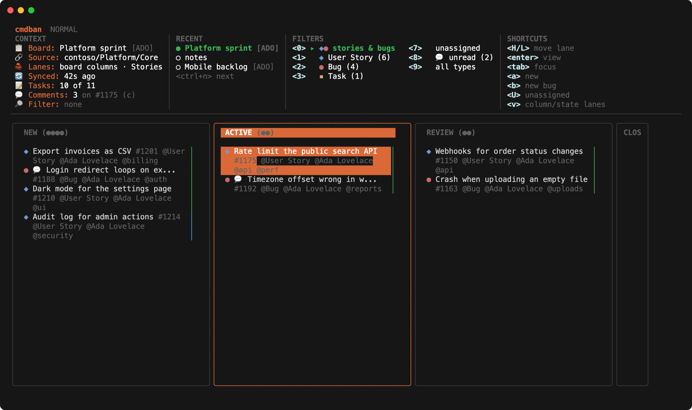
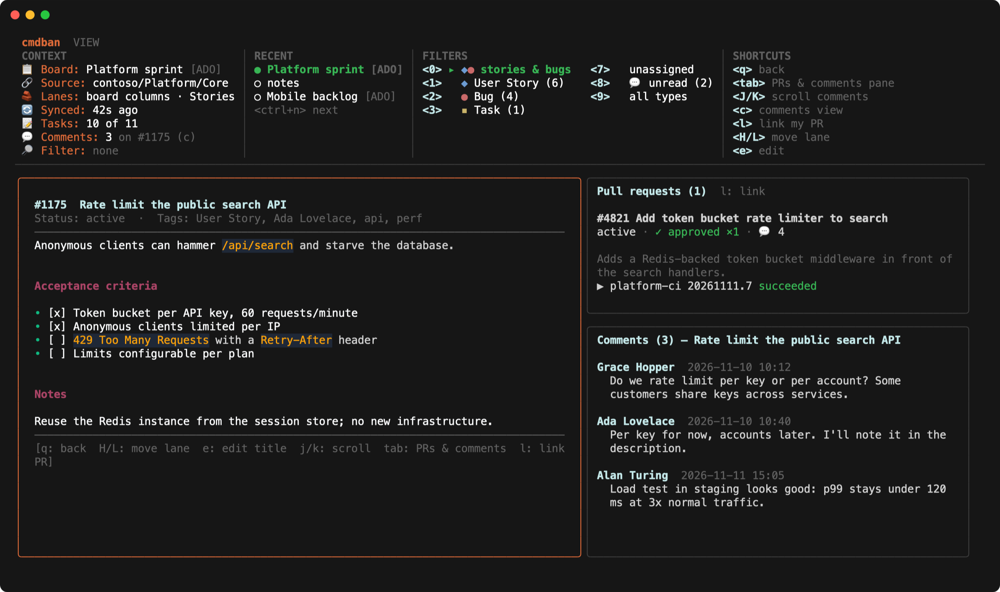
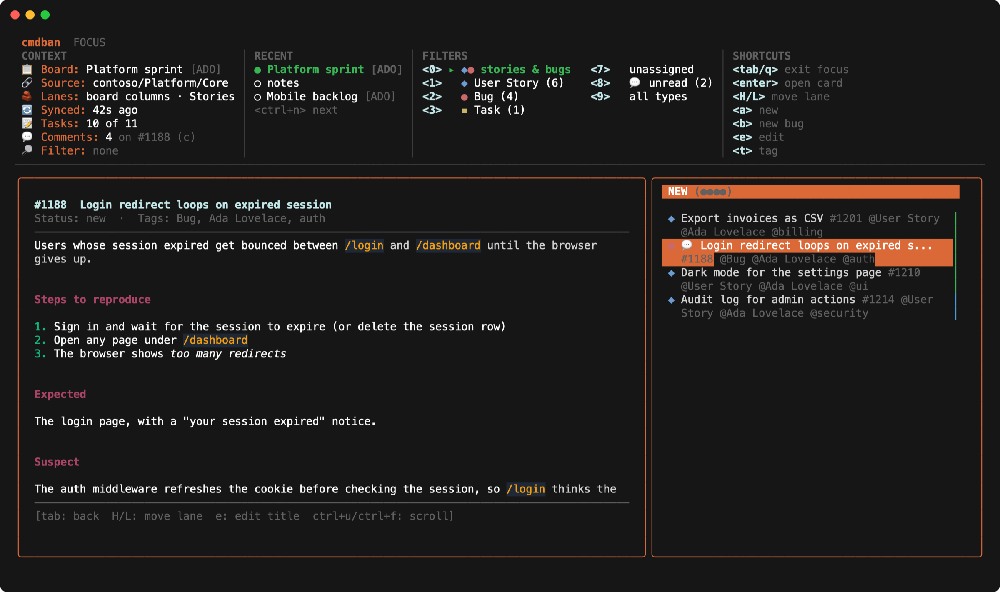

# cmdban

Akeyboard-driven Kanban board for the terminal, backed by plain markdown files or Azure DevOps sprints.

Move cards with vim motions, keep tasks as text you can grep and commit, or work your team's sprint board — read work items, follow linked PRs and pipelines, and comment — without leaving the terminal.



### Work your Azure DevOps sprint

Cards mirror the team's Kanban columns; moving one moves the work item. Filter by type with number keys, spot unread comments (💬, `8`), and open a work item to read its description, linked pull requests, pipeline runs and comments side by side (`tab`). Edit titles and descriptions in `$EDITOR` and post comments as markdown.



### Focus on one lane

Read cards one after another in a single lane with the details beside the list (`tab`), and move, edit or tag them as you go.



## Install

```bash
make build      # build ./cmdban
make install    # copy to /usr/local/bin
```

Or build directly with Go:

```bash
go build -o cmdban .
```

Run with `cmdban`. The config is created on first launch.

## Getting started

1. Launch the app: the default board keeps its tasks in `./tasks`. Press `a` to add a task, `H` / `L` to move it between lanes.
2. For Azure DevOps, run `:pats` and press `a` to add a personal access token, then open the board switcher (`ctrl+b`) and press `A` for the guided board setup.
3. Switch boards with `ctrl+b`, or cycle recent ones with `ctrl+n`. Press `?` for every shortcut.

Tasks are markdown files with a small metadata footer — see [task format](docs/task-format.md).

## Commands and keys

| Command | Action |
|---|---|
| `:b` | Board switcher |
| `:pats` | Manage personal access tokens |
| `:config` | Edit configuration |
| `:adocolumns [board]` | Sync lanes from an Azure DevOps board |
| `:logs` | Log viewer |
| `:q` | Quit |

| Key | Action |
|---|---|
| `h` / `l`, `j` / `k`, `enter` | Navigate and open |
| `a` / `e` / `x` | New / edit / delete task |
| `H` / `L` | Move task between lanes |
| `/` | Search |
| `0`–`9` | Azure DevOps filters (type, unassigned, unread comments) |
| `c` | Comments |
| `tab` | Focus mode, or the PR and comments pane in the task view |
| `?` / `q` | Help / back or quit |

See [all commands and shortcuts](docs/commands-and-keys.md).

## Configuration

Configuration is stored in `~/.cmdban.yaml`. Use `:config` to edit it in `$EDITOR` (`nvim` by default).

See [configuration](docs/configuration.md) for boards, columns and other options, and [Azure DevOps](docs/azure-devops.md) for connecting a sprint board.

## Development

```bash
make test    # all tests, verbose
make lint    # golangci-lint
make tidy
```
